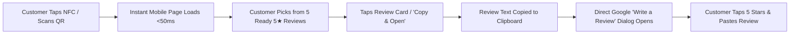

# 💎 Smart CONNECT QR — Zero-Effort SEO Google Review & Auto-Reply System
### Exclusively Configured for **Pink City Gems (Sector 23-C, Chandigarh)**

[](https://github.com/Nikhil-Verma22/auto_review/actions/workflows/deploy-pages.yml)
[](https://nikhil-verma22.github.io/auto_review/)
[](https://search.google.com/local/writereview?placeid=ChIJdSHXX7ztDzkRrOF75hIsEoc)
[](#)

---

## 🚀 Live System URLs

| Touchpoint | Direct Live Link | Purpose |
| :--- | :--- | :--- |
| **🔗 NFC & QR Target URL** | **[https://nikhil-verma22.github.io/auto_review/](https://nikhil-verma22.github.io/auto_review/)** | **Write this exact URL to your physical NFC cards/tags.** Opened instantly when a customer taps NFC or scans QR. |
| **🖨️ Printable Standee (4×6") & Studio** | **[https://nikhil-verma22.github.io/auto_review/standee.html](https://nikhil-verma22.github.io/auto_review/standee.html)** | 1-Click print countertop standees, dual-sided NFC cards, and download QR codes. |
| **⚙️ Owner Admin & AI Reply Studio** | **[https://nikhil-verma22.github.io/auto_review/admin.html](https://nikhil-verma22.github.io/auto_review/admin.html)** | Review pool statistics, 1-click AI owner reply generator for Google reviews, and config editor. |
| **🖼️ High-Res QR Code (1024×1024 PNG)** | **[qr-code.png](https://nikhil-verma22.github.io/auto_review/assets/qr-code.png)** | High-contrast, error-correction level `H` QR code for print and merchandise. |
| **📐 Scalable Vector QR Code (SVG)** | **[qr-code.svg](https://nikhil-verma22.github.io/auto_review/assets/qr-code.svg)** | Lossless vector QR code for banners, signage, and laser engraving. |

---

## 📱 Scannable QR Code Preview

<div align="center">
  
  <p><em>Scan with your smartphone camera to preview the live customer review experience.</em></p>
</div>

---

## ⚡ How It Works (The 3-Second Customer Journey)



1. **Tap or Scan**: Customer taps their phone against your NFC card or scans your countertop QR code.
2. **Instant Mobile Experience (<50ms)**: Pre-bundled static architecture loads instantaneously with zero database or server latency.
3. **5 Curated Ready-to-Use 5★ Reviews**:
   - 💎 **Certified Natural Gemstones** (Ceylon Pukhraj, Zambian Emerald, Burma Ruby, Blue Sapphire)
   - 🪐 **Astrological & Rashi Ratna** (Vedic birthstone recommendations, energized planetary stones)
   - ✨ **Healing Crystals & Rudraksha** (Authentic Himalayan Rudraksha, Amethyst, Pyramids, Chakra bracelets)
   - 💍 **Custom Rings & Pendants** (Vedic open-back settings in gold, silver, and panchdhatu)
   - 📜 **Wholesale & Lab Certification** (Govt/IGI lab reports, wholesale pricing in Sector 23 Chandigarh)
4. **Universal Generator & AI Review Framing Studio**: In `standee.html`, paste ANY Google Maps link (`maps.app.goo.gl/...` or full URL) to:
   - Extract canonical Place ID and sanitize business name (cleans phone numbers, SEO clutter, SCO numbers, and derives natural colloquial store name).
   - Auto-detect business industry (Grocery, Restaurant, Sweets/Bakery, Dental/Clinic, Salon, Auto Garage, Clothing, Electronics, etc.).
   - Frame 5 authentic, growth-driving 5★ reviews using Built-in Smart AI or Google Gemini API.
   - Edit, tweak, or apply reviews to live 4×6" standee, QR code, and NFC card.
5. **1-Tap Clipboard Copy & Seamless Direct Dialog**: Tapping any review card copies the text and automatically opens the Google "Write a Review" dialog directly via its canonical Place ID (`ChIJ...`).

---

## 🛠️ Repository Architecture

```text
├── .github/
│   └── workflows/
│       ├── generate-ai-reviews.yml       # Secure Gemini LLM Review Framing for any Maps URL (secrets.GEMINI_API_KEY)
│       ├── deploy-pages.yml              # Auto-generates QR assets, data bundle, & deploys to GitHub Pages
│       ├── claim-review.yml              # Manually mark a review as used globally
│       ├── replenish-seo-reviews.yml     # Automated weekly replenishment of fresh SEO reviews
│       └── auto-reply-google-reviews.yml # 24h cron to auto-reply to new Google reviews
├── config/
│   └── business.json                     # Master config: Business name, locality, CID, categories & keywords
├── data/
│   └── reviews.json                      # Pool of 5 curated natural 5-star reviews
├── scripts/
│   ├── generate_ai_reviews.mjs           # Secure Gemini AI review generator & business updater
│   ├── generate_qr_assets.mjs            # Generates qr-code.svg, qr-code.png (1024x1024), and data-bundle.js
│   ├── replenish_reviews.mjs             # Combinatorial SEO generation engine (+ optional Gemini API)
│   └── auto_reply_reviews.mjs            # Google Business Profile AI reply generator & API poller
├── public/                               # Published to https://nikhil-verma22.github.io/auto_review/
│   ├── .nojekyll                         # Bypasses Jekyll on GitHub Pages
│   ├── index.html                        # Mobile Customer Review Landing Page
│   ├── standee.html                      # Printable 4x6" Standee & AI Review Studio
│   ├── admin.html                        # Owner Dashboard & AI Reply Studio
│   └── assets/
│       ├── style.css                     # Premium responsive stylesheet (Outfit & Inter fonts)
│       ├── app.js                        # Client logic (clipboard, review rendering, redirect)
│       ├── ai-review-engine.js           # AI Review Framing Engine (Gemini API + Built-in Smart AI)
│       ├── google-maps-resolver.js       # Universal Google Maps URL & Place ID Decoder
│       ├── qrcode.min.js                 # Client-side QR code generator
│       ├── qr-code.png                   # High-res 1024x1024 PNG
│       ├── qr-code.svg                   # Scalable vector SVG
│       └── data-bundle.js                # Pre-bundled instant data store
├── package.json                          # Dependencies (qrcode)
└── README.md                             # Documentation & Setup Guide
```

---

## 📋 10-Second NFC Card Setup Guide

To write your live URL onto physical NFC tags/cards:

1. Download **NFC Tools** (free on iOS App Store & Android Google Play).
2. Open the app and tap **Write**.
3. Tap **Add a record** → Select **URL / URI**.
4. Enter your exact URL:
   ```text
   https://nikhil-verma22.github.io/auto_review/
   ```
5. Tap **OK** → Tap **Write / 28 Bytes**.
6. Touch the blank NFC card or sticker to the back of your phone until it chirps.
7. Your NFC review card is ready for customers!

---

## 🧪 Owner Testing Sandbox

1. Open `https://nikhil-verma22.github.io/auto_review/?test=1` on your phone or computer.
2. Toggle **🧪 Test Mode** in the footer bar.
3. Tap **⏸️ Pause Auto-Redirect** to test copying reviews without being redirected to Google Maps.
4. Tap **🔄 Reset My Copied Reviews** to clear your local testing history anytime.

---

## 🤖 AI Auto-Reply to Google Reviews

When customers leave reviews on your Google Business Profile:
1. Open the [Owner Admin Studio](https://nikhil-verma22.github.io/auto_review/admin.html).
2. Enter the customer's name, star rating, and review text.
3. Tap **✨ Generate 3 SEO Replies**.
4. Pick from **Warm & Grateful**, **SEO-Rich & Professional**, or **Short & Punchy**, and click **Copy Reply**.
5. Paste directly into your Google Business Profile manager!

*(Optional: Set `GOOGLE_BUSINESS_ACCOUNT_ID` and `GOOGLE_BUSINESS_ACCESS_TOKEN` in GitHub Repository Secrets to automate 24-hour replies via `.github/workflows/auto-reply-google-reviews.yml`)*.

---

## 📄 License & Attribution
Configured and deployed for **Pink City Gems**, Sector 23-C, Chandigarh. Powered by GitHub Pages and GitHub Actions. MIT License.
